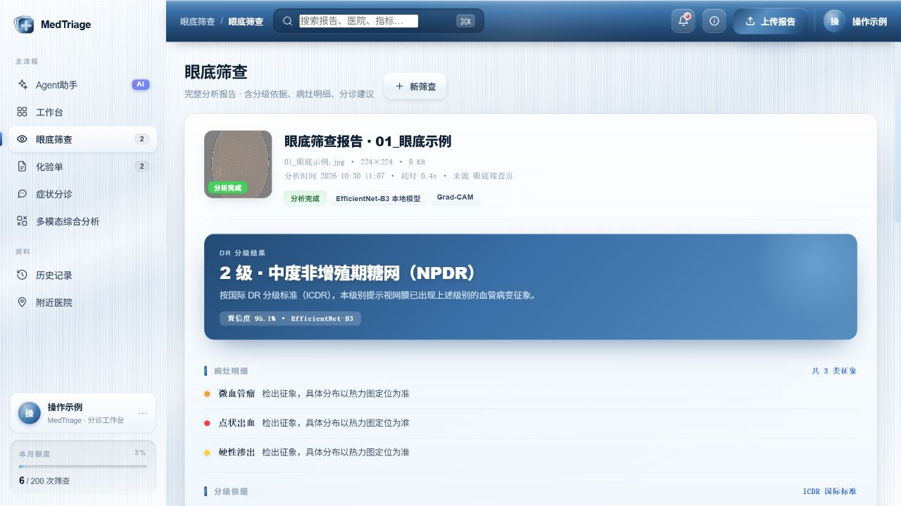
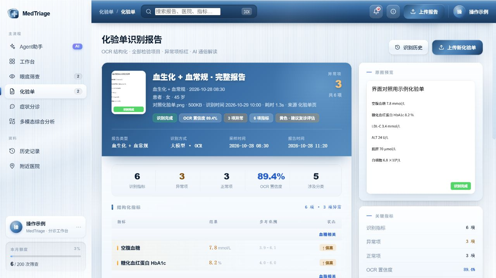

# MedTriage 项目亮点与技术特色

**[在线体验](http://101.37.180.16) · [代码仓库](https://github.com/llu799529-lang/chuanzhi-web) · [操作手册](02_作品介绍与操作手册.pdf)**

MedTriage 的特色在于将专用视觉模型、云端多模态服务、可追溯知识检索与确定性规则组合到同一条就医信息流程中。用户从一张图片或一句症状开始，可以继续查看报告、整理历史、了解建议科室与附近医院。

## 一、眼底筛查具备独立的本地模型链路

系统使用本地 EfficientNet-B3 权重进行 DR 五级分类，保留各级概率，并通过水平翻转测试时增强（TTA）汇总预测。真实模型就绪时，专用眼底页面的分级不依赖云端大模型 Key。

这让眼底任务拥有明确的模型、输入处理和输出契约。报告还能继续给出图像质量、分诊参考、复查与就诊准备，让分类结果进入可使用的业务流程。

既有 508 张 test 图片的五级准确率为 76.57%，QWK 为 0.8958。两项指标与测试规模一起展示，完整混淆矩阵和逐图结果可从仓库核对。

实现依据：[fundus.py](backend/fundus.py)、[screening.py](backend/screening.py)、[triage.py](backend/triage.py)、[评测报告](backend/evals/fundus_report.json)。

*图为操作手册中的界面演示，显示数值为示例，不作为模型评测结果。*

## 二、图像质量与双眼汇总共同参与结果表达

质量检测对清晰度、亮度、颜色与有效视野给出规则提示，帮助用户理解照片是否适合评估。示例 A、B 使用实际上传接口，分别演示普通照片与失焦照片的处理过程。

双眼模式分别保留左右眼报告，再按可评估眼中较重的等级汇总就医参考。不可评估的眼单独提示重拍，两眼都不可评估时不输出联合分级；两眼差异较大时，摘要会提示携带差异信息就诊。

这些细节把“单张图片分类”延伸为双眼信息整理，保留每只眼的状态与依据，避免把无法评估的照片混入正常结论。

实现依据：[quality_check.py](backend/quality_check.py)、[bilateral.ts](frontend/src/lib/bilateral.ts)、[fundusDemo.ts](frontend/src/lib/fundusDemo.ts)。

## 三、专业阅片把模型结果变成可对照的图像界面

阅片组件提供原图、亮度 CLAHE 增强与绿色通道视图，支持透明 Grad-CAM 热力层、强度调节、并排对照与同步放大。热力层按模型实际输入的中心区域映射回图像，并处理 EXIF 方向。

底图增强和通道切换在浏览器执行，切换显示方式不改写分级与概率，也不因此重新调用模型。用户可以在同一张原图上对照不同视图，理解结果与图像的对应关系。

Grad-CAM 展示模型关注区域，配合原图与质量提示解读；它与临床病灶定位标注属于不同概念。

实现依据：[FundusViewer.vue](frontend/src/features/workbench/components/FundusViewer.vue)、[fundusImage.ts](frontend/src/lib/fundusImage.ts)、[fundus.py](backend/fundus.py)。

## 四、化验单在结构化识别之后还有数值核验

视觉模型抽取项目、数值、单位、参考范围与异常标记，页面再生成分类表、逐项解读和摘要。纯规则核验模块继续检查单位、数量级、小数点疑点、参考范围和箭头的一致性。

例如，同一个血糖值与单位或参考区间不匹配时，系统可以标注需要对照原单核对的项目。核验只增加提示，保留原识别值，用户可以回看原图再确认。

这一设计同时照顾结构化数据的可用性和原始信息的可追溯性，也为后续综合分析提供更清楚的数据背景。规则核验本身不产生额外模型调用。

实现依据：[lab_check.py](backend/lab_check.py)、[ai_analysis.py](backend/ai_analysis.py)、[LabPage.vue](frontend/src/features/workbench/pages/LabPage.vue)。

*图为合成化验单的界面演示，用于展示报告结构，不作为真实化验识别准确率。*

## 五、Agent 把对话连接到真实工具与事件流

工作台采用原生 Function Calling。工具覆盖历史记录、图片分析、知识库检索、进展辅助评估、医院检索与必要追问，工具可用性随部署配置调整。

前端通过 SSE 展示规则规划、工具开始与返回、逐字报告、自检和最终结果。用户既能读报告，也能看到系统正在完成哪类任务，长任务的过程更清晰。

报告生成后，自检将分级、急症提示、紧急程度、越界表述及引用与工具结果进行核对。符合条件的问题最多触发一次定向重写，并依据复检结果决定是否采用，过程有明确边界。

实现依据：[agent2.py](backend/agent2.py)、[tool_specs.py](backend/tool_specs.py)、[planner.py](backend/planner.py)、[useAgentStream.ts](frontend/src/composables/useAgentStream.ts)。

## 六、RAG 把检索、引用和来源连接起来

检索覆盖关键词、bigram、双向同义词与否定处理，使用户的日常说法能够与知识条目对应。知识库共 100 条，其中 94 条具有登记来源；报告中的编号引用可连接到相应证据与文献。

引用模块还会检查编号是否落在实际证据范围内。用户可以从一段解释继续打开来源，开发者也能追踪报告使用了哪些知识条目。

64 条作者自建留出查询的 Top-3 命中率为 93.8%、MRR@3 为 0.849；10 条非医疗负例误召回为 0。这里衡量的是指定查询集的检索表现，医学回答质量另按任务验证。

实现依据：[rag.py](backend/rag.py)、[citations.py](backend/citations.py)、[来源登记](backend/kb_sources.json)、[检索报告](backend/evals/retrieval_compare.json)。

## 七、关键安全行为由确定性规则承接

系统包含 22 条急症规则与数值闸门，并处理否定、既往描述等语义线索。命中红色急症规则时直接输出相应指引，紧急程度托底采用只升不降的处理。

安全规则与模型生成分工明确：规则承接必要的风险提示，模型负责信息组织与解释。即使在线服务暂不可用，已有的急症规则、知识库与明确标注的离线流程仍可以工作。

文字输入与记录写入经过脱敏处理，账号记录、会话和前端缓存按用户隔离；服务还有上传校验、限流和超时控制。多项机制围绕同一条实际使用流程协同工作。

实现依据：[safety.py](backend/safety.py)、[guardrails.py](backend/guardrails.py)、[records.py](backend/records.py)、[auth.py](backend/auth.py)。

## 八、多模态信息继续进入综合分析和就医导航

眼底、化验与症状结果可以进入同一账号的历史记录，再为综合分析提供上下文。综合分析同时接收化验明细，让解释能够结合具体项目，而不只依赖一条概括摘要。

报告继续连接到建议科室、就诊准备与附近医院。用户可以从理解结果自然进入下一步信息查询，减少在多个页面之间重新描述或整理材料的负担。

综合分析属于跨记录、跨模态的信息编排，医院结果按部署中的地图与 POI 配置提供。各模块有独立输出，也能共同组成连续的使用路径。

实现依据：[screening.py](backend/screening.py)、[MultiPage.vue](frontend/src/features/workbench/pages/MultiPage.vue)、[hospitals.py](backend/hospitals.py)。

## 九、同一批业务能力能够通过 HTTP、Agent 和 MCP 复用

后端将 HTTP 协议、业务编排、模型、规则和数据访问分层。Agent 和独立 stdio MCP Server 复用已有业务模块，MCP 对外提供 7 个工具。

复用的价值体现在一致性：眼底分级、记录脱敏或急症规则有统一实现，网页与工具入口可以共享同一套业务行为。需要连接支持 stdio MCP 的宿主时，可以沿用这些能力。

结构检查覆盖依赖层级、循环导入、入口依赖、记录读写边界、接口清单及前后端地址对应，让架构约束能够由测试检查。

实现依据：[mcp_server.py](backend/mcp_server.py)、[架构说明](docs/ARCHITECTURE.md)、[架构测试](backend/tests/test_architecture.py)、[接口契约测试](backend/tests/test_api_contract.py)。

## 十、可运行、可验证的工程交付

仓库提供 Vue/TypeScript 源码和 dist、模型权重、环境模板、命名启动脚本、图文手册、示例素材与公网入口。首次使用可以从在线体验开始，需要复现时再查看源码与环境配置。

启动器复用已有可用依赖；文本与视觉模型分别配置，自动付费切换默认关闭。上传、流式反馈、错误处理与个人记录共同构成完整应用体验。

2026-11-14 本机真实 FastAPI 下后端 964 项测试、前端 194 项测试通过，合计 1158 项用例；类型检查和 Vite 生产构建通过。测试既覆盖函数与接口，也覆盖报告联动、取消、账号切换和架构约束。

实现依据：[运行检查](tools/check_runtime.py)、[模型配置](backend/config.py)、[工程验证](docs/ENGINEERING_VALIDATION.md)、[前端测试](frontend/tests)。

## 可直接使用的作品介绍

> MedTriage 围绕眼底、化验与症状三类输入，构建从筛查参考到就医导航的连续流程。系统结合本地眼底模型、视觉结构化识别、知识检索与真实工具调用，提供质量提示、专业阅片、双眼汇总、数值核验和可追溯报告，并通过安全规则、账号隔离与自动化测试支撑工程运行。

## 建议优先展示的三个片段

| 片段 | 展示重点 |
|---|---|
| 眼底示例 → 阅片 → 双眼 | 专用模型、图像质量与实际图像交互相互衔接 |
| 已有化验记录 → 原图 → 核验提示 | 结构化之后保留原值，并提供数据核对依据 |
| Agent → 工具 → 引用 → 就医信息 | 对话、工具执行、知识来源和后续操作连成流程 |

完整操作见手册，模型与检索数据见 [评测说明](docs/EVAL.md)。系统提供筛查与就医信息参考，实际诊疗由医生决定。
